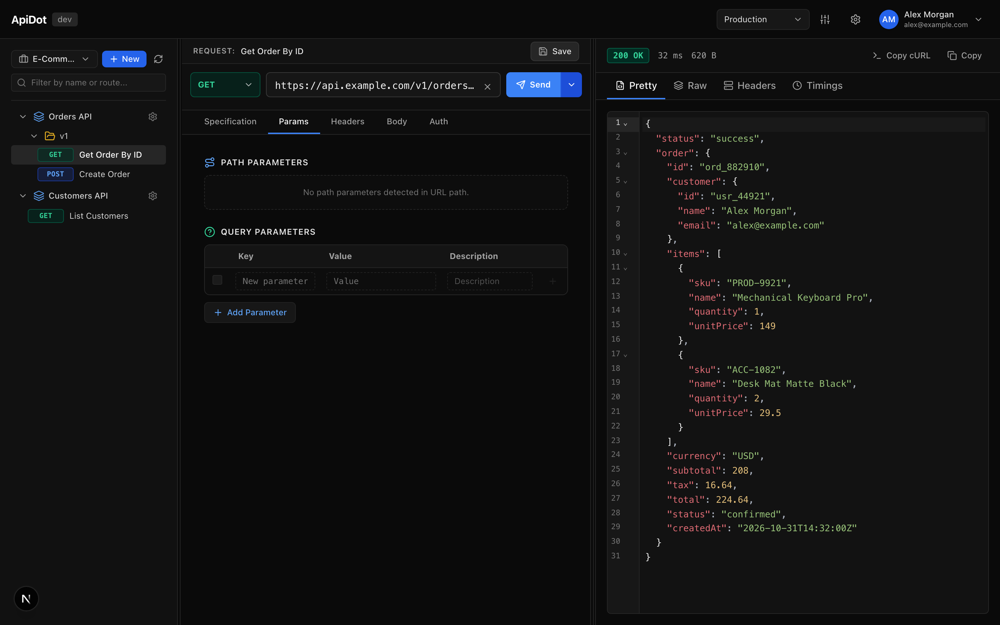
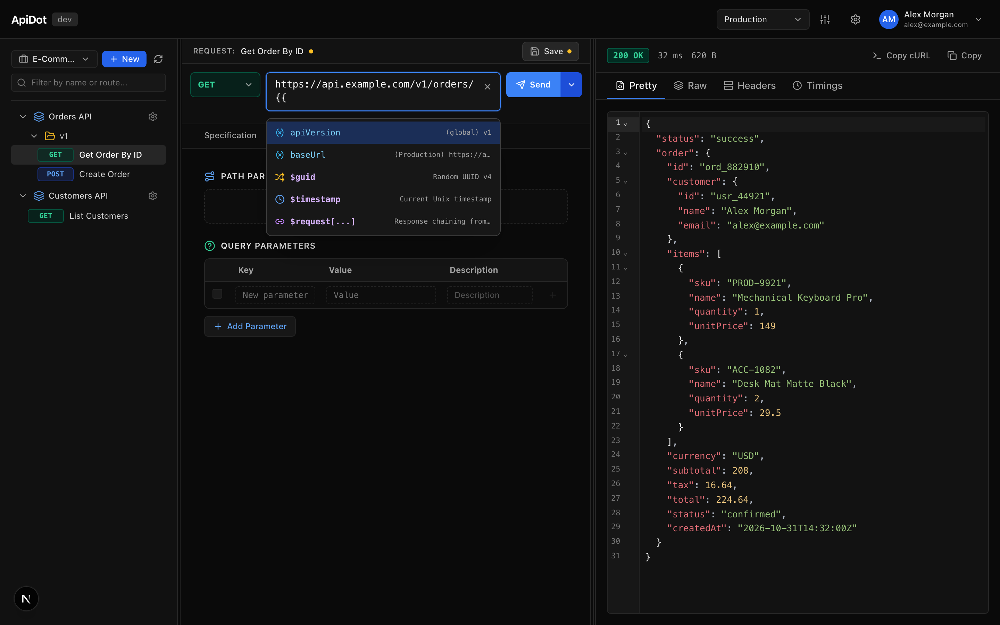
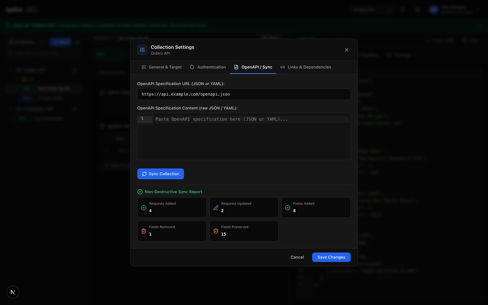
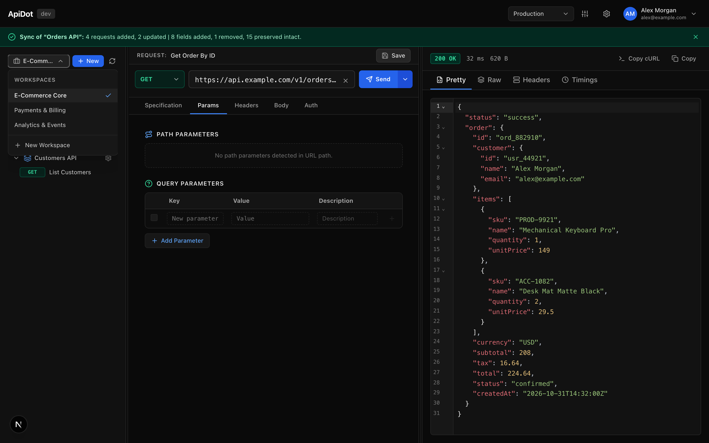
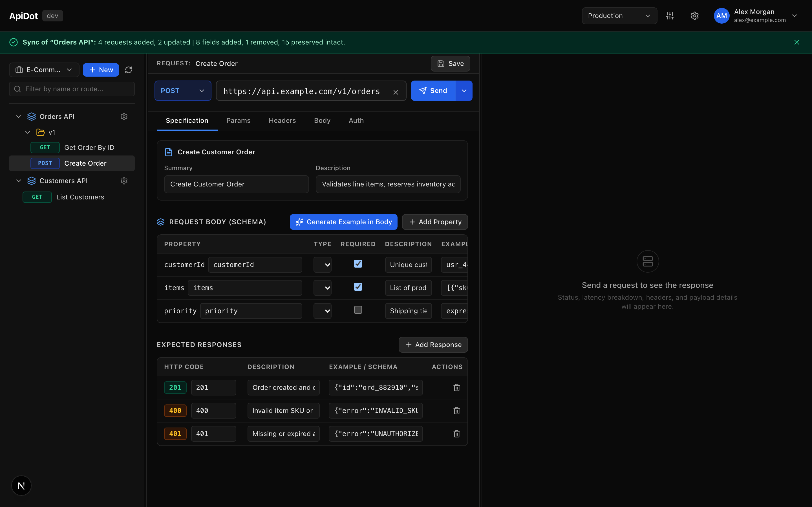

# ⚡ ApiDot

> Test and debug any API, anywhere — from localhost to production.

[](https://github.com/medeiroshudson/ApiDot/releases)
[](https://opensource.org/licenses/MIT)
[](https://nextjs.org/)
[](https://dotnet.microsoft.com/)
[](https://www.docker.com/)

---



---

## 📖 Overview

**ApiDot** is a modern, lightweight, privacy-first API client and workspace built for developers who demand speed, clarity, and complete infrastructure control.

Most contemporary API clients have grown heavy, intrusive, and burdened by mandatory cloud synchronization. ApiDot takes the opposite path: a self-hosted platform combining a snappy web workspace with hybrid execution capabilities. Run it on your local machine, host it inside your private homelab, or deploy it into your production cloud — your requests, environment secrets, and schemas remain strictly under your control.

Whether you are testing an internal microservice, debugging third-party webhooks, or probing `localhost` endpoints behind a strict corporate VPN, ApiDot gives you the exact tools to test, inspect, and iterate faster.

---

## ✨ Key Features

| Feature | Description |
|---|---|
| 🎯 **Full-featured Request Editor** | Multi-method HTTP client (`GET`, `POST`, `PUT`, `DELETE`, `PATCH`, `HEAD`, `OPTIONS`) with support for query parameters, custom headers, and raw, JSON, or form-data payloads powered by CodeMirror 6. |
| ⚡ **Precise Latency Metrics** | Real-time diagnostic timing breakdown isolating DNS resolution, TCP connect, TLS handshake, TTFB (time to first byte), and content download phases. |
| 🧩 **Cascading Variables (`{{...}}`)** | Hierarchical variable resolution across Global, Environment, and Collection scopes with rich inline autocomplete and response chaining. |
| 🔄 **OpenAPI v3 Sync & Audit** | Import OpenAPI v3 / Swagger specifications from URLs or raw JSON/YAML with detailed change auditing to prevent accidental regressions. |
| 📋 **Interactive Request Specification** | Built-in OpenAPI schema inspector with property tree navigation, type contracts, required field indicators, expected status response codes, and 1-click body example generation. |
| 💻 **Hybrid Execution Engine** | Dispatch requests either directly from your centralized server or through the Native AOT **ApiDot Agent** daemon running locally on your workstation to effortlessly reach `localhost` and internal subnets. |
| 🔗 **Deep Linking & Workspace State** | Declarative URLs per workspace, collection, and request (`/workspace/:id/request/:id`) enabling seamless bookmarking, sharing, and state persistence across page reloads. |

---

## 🚀 Quick Start (Docker Compose)

Get a fully functioning ApiDot instance up and running in under 30 seconds using Docker:

```bash
# 1. Clone the repository
git clone https://github.com/medeiroshudson/ApiDot.git
cd ApiDot

# 2. Launch server and web services
docker compose up -d
```

Open your browser and navigate to:
```text
http://localhost:3000
```

To stop all services:
```bash
docker compose down
```

---

<details>
<summary>📸 <strong>Visual Feature Tour (Click to expand screenshots)</strong></summary>

<br />

### 1. Smart Variable Autocomplete & Chaining
Type `{{` anywhere in your request URL, headers, or body to trigger instant fuzzy autocomplete across all scoped variables.



---

### 2. OpenAPI v3 Specification Sync & Audit
Import schemas directly from live endpoints or specification files. Audit every added, modified, or removed endpoint before applying updates to your workspace collections.



---

### 3. Hierarchical Workspace & Collection Tree
Organize complex API surfaces with nested collections and folders. Manage environments, inspect execution history, and search endpoints with sub-millisecond response times.



---

### 4. Interactive OpenAPI Schema & Specification
Inspect and define structured request contracts, required parameters, property trees, and expected response codes directly inside the request editor — complete with instant sample payload generation.



</details>

---

## 🛠️ Local Development

If you prefer to run ApiDot directly on your machine or contribute to its development:

### Prerequisites
- [.NET 9 SDK](https://dotnet.microsoft.com/download/dotnet/9.0)
- [Node.js 20+](https://nodejs.org/) & `npm`
- [Docker](https://www.docker.com/) (optional, for containerized workflows)

### Option A: Running with Hot Reload (Docker Compose Dev)
```bash
docker compose -f docker-compose.dev.yml up --build
```

### Option B: Running Manually

#### 1. Backend Server (`ApiDot.Server`)
```bash
cd backend
dotnet run --project src/ApiDot.Server
```
*The server API and WebSocket hub will listen at `http://localhost:5001` (or `http://localhost:5000`).*

#### 2. Frontend Web Client (`Next.js 15`)
```bash
cd frontend
npm install
npm run dev
```
*The web interface will be available at `http://localhost:3000`.*

#### 3. Run Tests
```bash
# Backend unit & integration tests
dotnet test backend/ApiDot.sln

# Frontend tests
npm --prefix frontend test
```

---

## 🏗️ Architecture

ApiDot is engineered as a clean, decoupled system consisting of three primary components:

```
┌────────────────────────────────────────────────────────┐
│                   ApiDot Web Client                    │
│          Next.js 15 • React 19 • Zustand • CodeMirror  │
└───────────────────────────┬────────────────────────────┘
                            │ REST / Server-Sent Events
                            ▼
┌────────────────────────────────────────────────────────┐
│                   ApiDot Server                        │
│          .NET 9 Minimal APIs • SQLite • EF Core        │
└───────────────────────────┬────────────────────────────┘
                            │ Reverse WebSockets
                            ▼
┌────────────────────────────────────────────────────────┐
│                   ApiDot Agent                         │
│       .NET 9 Native AOT CLI & Background Daemon        │
│       (Localhost, VPN, and Private Network Access)     │
└────────────────────────────────────────────────────────┘
```

1. **Frontend (`frontend`)**: Next.js 15 App Router application with React 19, Tailwind CSS, Zustand for reactive workspace state, and CodeMirror 6 for high-performance payload editing.
2. **Backend Server (`backend/src/ApiDot.Server`)**: High-throughput ASP.NET Core 9 Minimal API service backed by SQLite for fast, portable, zero-configuration local persistence.
3. **Local Agent (`backend/src/ApiDot.Agent`)**: Zero-dependency Native AOT executable compiling to single-file binaries across macOS, Linux, and Windows. It registers as a system service (`launchd`, `systemd`, `schtasks`) and executes requests locally when configured as the execution target.

---

## 🤝 Contributing

Contributions, issues, and feature requests are welcome!

1. Fork the project on GitHub.
2. Create your feature branch (`git checkout -b feature/amazing-feature`).
3. Commit your changes (`git commit -m "feat: add amazing feature"`).
4. Ensure all tests pass (`dotnet test backend/ApiDot.sln` and `npm --prefix frontend test`).
5. Push to the branch (`git push origin feature/amazing-feature`).
6. Open a Pull Request.

Please check open [Issues](https://github.com/medeiroshudson/ApiDot/issues) before starting major architectural changes.

---

## 📄 License

This project is licensed under the [MIT License](https://opensource.org/licenses/MIT).
